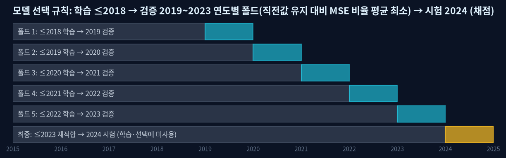
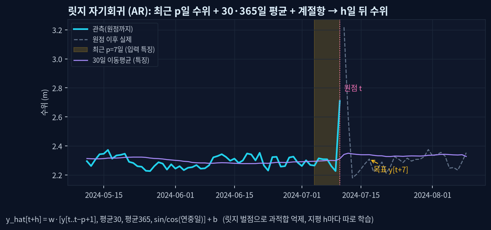
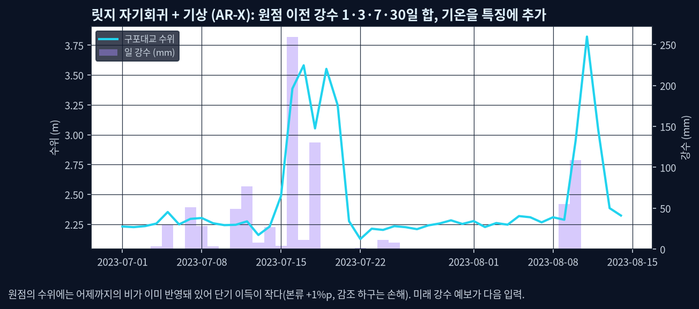
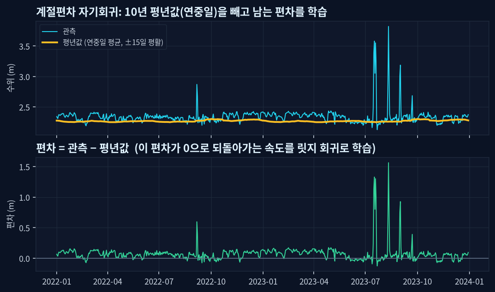
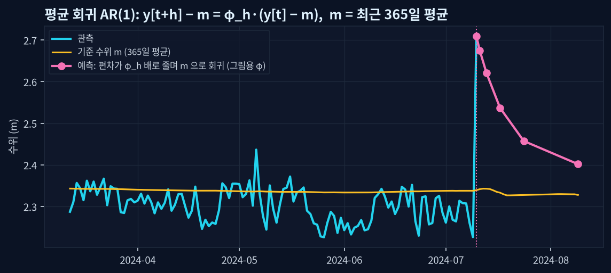
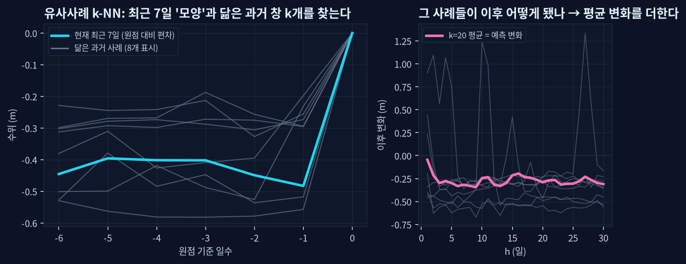
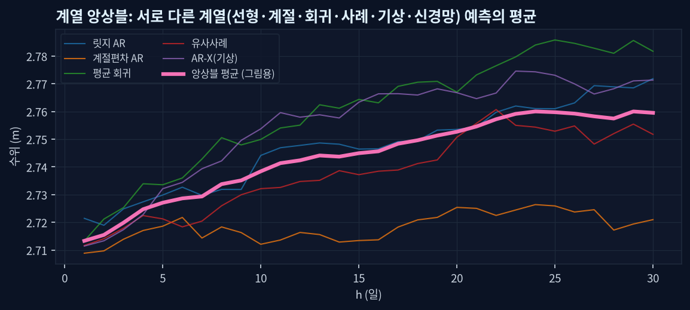
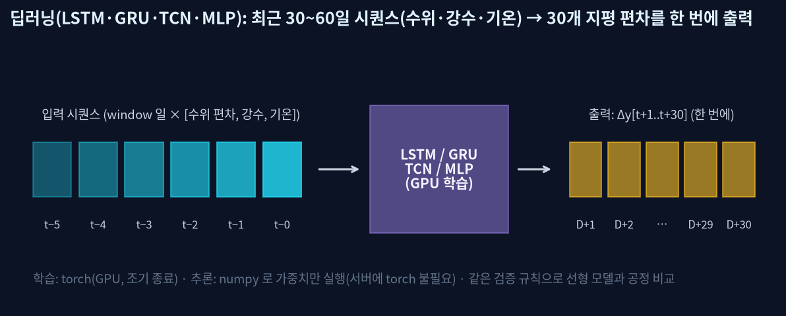
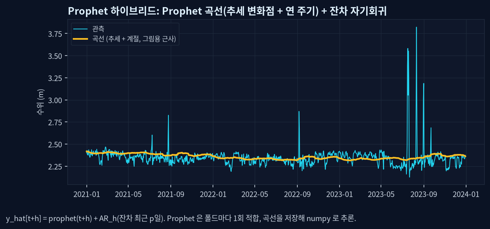
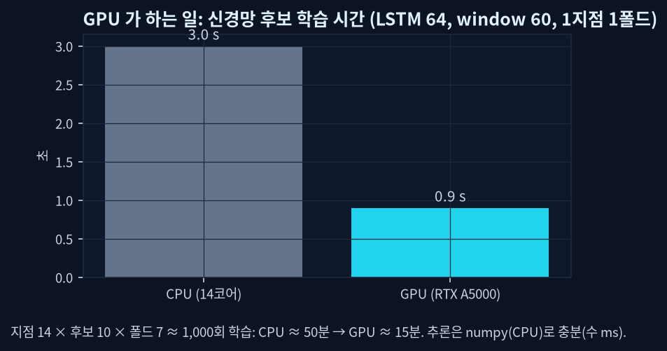

# 수위 시계열 예측 모델 비교 — 지역별 실증 결과

학습 산출물 기준 자동 생성. 지점 26개 × 예측일수 30 = 780셀.

## 1. 왜 여러 모델을 비교했나

- 수위는 지형(감조 하구·본류·지류·저수지)마다 움직임이 달라 단일 모델을 강요할 근거가 없다.
- 그래서 선형·계절·회귀·사례·기상·딥러닝(GPU)·Prophet 계열 13종을 **같은 규칙**(검증 연도별 폴드 → 시험 연도)으로 비교하고 지점×예측일수마다 이긴 모델을 쓴다.
- 직전값 유지(persistence)는 기준선일 뿐이며 절대 선택되지 않는다. 개선율(skill) = 1 − MSE/MSE(직전값 유지).

## 2. 검증 규칙

학습 ≤2018 → 검증 2019~2023(연도별 5폴드, persistence 대비 MSE 비율 평균 최소 후보 선택) → 시험 2024(학습·선택 미사용). 대청은 자료가 2019년부터라 검증 3폴드.

## 3. 모델 설명

### 릿지 자기회귀 (AR)

최근 p일 수위·30/365일 평균·계절항의 선형 조합. 릿지 벌점으로 과적합 억제. delta/level 모드.

### 릿지 자기회귀 + 기상

원점 이전 강수 1·3·7·30일 합·기온 편차를 추가. 미래 강수는 쓰지 않는다.

### 계절편차 자기회귀

평년값(연중일 평균)을 뺀 편차의 되돌아감을 학습.

### 평균 회귀 AR(1)

기준 수위(최근 30·90·365일 평균)로 되돌아가는 비율 하나를 지평마다 학습. 조석 지점에서 강함.

### 유사사례 k-NN

최근 7~14일 모양과 닮은 과거 사례 k개의 이후 변화 평균.

### 계열 앙상블

계열이 다른 모델 6개(기상 포함)의 평균. 한 해에 과적합되기 어렵다.

### 딥러닝 4종 (MLP·LSTM·GRU·TCN)

최근 30~60일 시퀀스(수위·강수·기온)로 30개 지평 편차를 한 번에 출력. GPU(torch) 학습, numpy 추론.

### Prophet 하이브리드

Prophet 곡선(추세 변화점+연 주기) + 잔차 변화량 자기회귀.

## 4. 모델 계열별 검증 성적 (persistence 대비 MSE 비율, 낮을수록 좋음 · 26지점 중앙값)

| 모델 | D+1 | D+3 | D+7 | D+14 | D+30 |
|---|---|---|---|---|---|
| TCN(GPU) | 0.965 | 0.831 | 0.731 | 0.692 | 0.666 |
| 계열 앙상블 | 0.911 | 0.813 | 0.736 | 0.708 | 0.684 |
| LSTM(GPU) | 0.921 | 0.795 | 0.740 | 0.720 | 0.699 |
| MLP 신경망(GPU) | 0.969 | 0.822 | 0.743 | 0.698 | 0.669 |
| 평균 회귀 AR(1) | 0.938 | 0.824 | 0.745 | 0.708 | 0.695 |
| 계절편차 자기회귀 | 0.942 | 0.828 | 0.750 | 0.706 | 0.715 |
| GRU(GPU) | 0.935 | 0.814 | 0.756 | 0.705 | 0.679 |
| 릿지 자기회귀 | 0.934 | 0.815 | 0.759 | 0.739 | 0.706 |
| 릿지 자기회귀+기상 | 0.873 | 0.827 | 0.776 | 0.749 | 0.717 |
| 유사사례 k-NN | 0.922 | 0.842 | 0.798 | 0.822 | 0.838 |
| Prophet+잔차AR | 1.024 | 1.013 | 0.997 | 1.172 | 1.071 |
| 계절 평년값 | 7.355 | 2.421 | 1.608 | 1.435 | 1.203 |

비율 1.0 = 직전값 유지와 같음. 0.7 = MSE 30% 감소. 중앙값을 쓴 이유: Prophet·계절 평년값은 저수지 지점에서 추세 표류로 크게 나빠져 평균이 왜곡된다.

## 4-1. 모델별 성능지표 — 시험 연도 2024, 26지점 가중평균 (RMSE·MSE·MAE, 개선율)

선택 여부와 무관하게 **모든 계열을 같은 시험 구간에서 채점**한 값. 직전값 유지(기준선)도 함께 채점해 개선율 0 %의 위치를 보인다.

### D+1

| 모델 | 지점 | 선택 지점 | 평균 RMSE | 평균 MSE | 평균 MAE | 평균 개선율 |
|---|---|---|---|---|---|---|
| 릿지 자기회귀+기상 | 26 | 8 | 0.157 m (15.7 cm) | 0.03159 m² (315.9 cm²) | 0.073 m (7.3 cm) | +19.2 % |
| 계열 앙상블 | 26 | 3 | 0.162 m (16.2 cm) | 0.03407 m² (340.7 cm²) | 0.069 m (6.9 cm) | +15.3 % |
| 릿지 자기회귀 | 26 | 0 | 0.164 m (16.4 cm) | 0.03489 m² (348.9 cm²) | 0.071 m (7.1 cm) | +13.7 % |
| 계절편차 자기회귀 | 26 | 0 | 0.163 m (16.3 cm) | 0.03444 m² (344.4 cm²) | 0.071 m (7.1 cm) | +13.5 % |
| 유사사례 k-NN | 26 | 5 | 0.167 m (16.7 cm) | 0.03573 m² (357.3 cm²) | 0.068 m (6.8 cm) | +8.7 % |
| 평균 회귀 AR(1) | 26 | 4 | 0.169 m (16.9 cm) | 0.03696 m² (369.6 cm²) | 0.073 m (7.3 cm) | +8.2 % |
| Prophet+잔차AR | 26 | 0 | 0.172 m (17.2 cm) | 0.04075 m² (407.5 cm²) | 0.095 m (9.5 cm) | +7.3 % |
| TCN(GPU) | 26 | 0 | 0.176 m (17.6 cm) | 0.04260 m² (426.0 cm²) | 0.086 m (8.6 cm) | +1.0 % |
| MLP 신경망(GPU) | 26 | 0 | 0.171 m (17.1 cm) | 0.03748 m² (374.8 cm²) | 0.082 m (8.2 cm) | +0.9 % |
| 직전값 유지(기준선) | 26 | 0 | 0.176 m (17.6 cm) | 0.03943 m² (394.3 cm²) | 0.071 m (7.1 cm) | +0.0 % |
| GRU(GPU) | 26 | 4 | 0.172 m (17.2 cm) | 0.03755 m² (375.5 cm²) | 0.081 m (8.1 cm) | -13.8 % |
| LSTM(GPU) | 26 | 2 | 0.173 m (17.3 cm) | 0.03759 m² (375.9 cm²) | 0.082 m (8.2 cm) | -15.9 % |
| 계절 평년값 | 26 | 0 | 0.864 m (86.4 cm) | 2.97513 m² (29751.3 cm²) | 0.721 m (72.1 cm) | -14877.8 % |

### D+3

| 모델 | 지점 | 선택 지점 | 평균 RMSE | 평균 MSE | 평균 MAE | 평균 개선율 |
|---|---|---|---|---|---|---|
| 계열 앙상블 | 26 | 5 | 0.270 m (27.0 cm) | 0.10815 m² (1081.5 cm²) | 0.129 m (12.9 cm) | +24.4 % |
| 릿지 자기회귀+기상 | 26 | 1 | 0.269 m (26.9 cm) | 0.10468 m² (1046.8 cm²) | 0.134 m (13.4 cm) | +24.0 % |
| 계절편차 자기회귀 | 26 | 2 | 0.271 m (27.1 cm) | 0.10724 m² (1072.4 cm²) | 0.133 m (13.3 cm) | +23.5 % |
| 릿지 자기회귀 | 26 | 1 | 0.273 m (27.3 cm) | 0.11122 m² (1112.2 cm²) | 0.136 m (13.6 cm) | +22.8 % |
| TCN(GPU) | 26 | 0 | 0.273 m (27.3 cm) | 0.11099 m² (1109.9 cm²) | 0.137 m (13.7 cm) | +22.4 % |
| GRU(GPU) | 26 | 2 | 0.275 m (27.5 cm) | 0.11138 m² (1113.8 cm²) | 0.137 m (13.7 cm) | +20.1 % |
| 평균 회귀 AR(1) | 26 | 5 | 0.281 m (28.1 cm) | 0.11883 m² (1188.3 cm²) | 0.134 m (13.4 cm) | +19.8 % |
| MLP 신경망(GPU) | 26 | 2 | 0.278 m (27.8 cm) | 0.11396 m² (1139.6 cm²) | 0.140 m (14.0 cm) | +17.8 % |
| LSTM(GPU) | 26 | 5 | 0.283 m (28.3 cm) | 0.12180 m² (1218.0 cm²) | 0.140 m (14.0 cm) | +17.5 % |
| 유사사례 k-NN | 26 | 3 | 0.284 m (28.4 cm) | 0.11742 m² (1174.2 cm²) | 0.130 m (13.0 cm) | +15.7 % |
| Prophet+잔차AR | 26 | 0 | 0.311 m (31.1 cm) | 0.18844 m² (1884.4 cm²) | 0.209 m (20.9 cm) | +10.0 % |
| 직전값 유지(기준선) | 26 | 0 | 0.306 m (30.6 cm) | 0.13369 m² (1336.9 cm²) | 0.136 m (13.6 cm) | +0.0 % |
| 계절 평년값 | 26 | 0 | 0.865 m (86.5 cm) | 2.98336 m² (29833.6 cm²) | 0.722 m (72.2 cm) | -2445.6 % |

### D+5

| 모델 | 지점 | 선택 지점 | 평균 RMSE | 평균 MSE | 평균 MAE | 평균 개선율 |
|---|---|---|---|---|---|---|
| 계열 앙상블 | 26 | 5 | 0.319 m (31.9 cm) | 0.16943 m² (1694.3 cm²) | 0.164 m (16.4 cm) | +28.7 % |
| 계절편차 자기회귀 | 26 | 2 | 0.321 m (32.1 cm) | 0.17483 m² (1748.3 cm²) | 0.172 m (17.2 cm) | +27.5 % |
| 릿지 자기회귀+기상 | 26 | 1 | 0.319 m (31.9 cm) | 0.16711 m² (1671.1 cm²) | 0.171 m (17.1 cm) | +27.2 % |
| 릿지 자기회귀 | 26 | 1 | 0.322 m (32.2 cm) | 0.17533 m² (1753.3 cm²) | 0.172 m (17.2 cm) | +27.1 % |
| GRU(GPU) | 26 | 2 | 0.323 m (32.3 cm) | 0.17485 m² (1748.5 cm²) | 0.167 m (16.7 cm) | +26.1 % |
| MLP 신경망(GPU) | 26 | 3 | 0.324 m (32.4 cm) | 0.17327 m² (1732.7 cm²) | 0.171 m (17.1 cm) | +25.0 % |
| TCN(GPU) | 26 | 3 | 0.326 m (32.6 cm) | 0.17990 m² (1799.0 cm²) | 0.169 m (16.9 cm) | +24.4 % |
| 평균 회귀 AR(1) | 26 | 5 | 0.332 m (33.2 cm) | 0.18845 m² (1884.5 cm²) | 0.171 m (17.1 cm) | +24.2 % |
| LSTM(GPU) | 26 | 2 | 0.330 m (33.0 cm) | 0.18215 m² (1821.5 cm²) | 0.173 m (17.3 cm) | +22.7 % |
| 유사사례 k-NN | 26 | 2 | 0.337 m (33.7 cm) | 0.18464 m² (1846.4 cm²) | 0.165 m (16.5 cm) | +18.9 % |
| Prophet+잔차AR | 26 | 0 | 0.387 m (38.7 cm) | 0.36210 m² (3621.0 cm²) | 0.280 m (28.0 cm) | +9.9 % |
| 직전값 유지(기준선) | 26 | 0 | 0.370 m (37.0 cm) | 0.21533 m² (2153.3 cm²) | 0.175 m (17.5 cm) | +0.0 % |
| 계절 평년값 | 26 | 0 | 0.865 m (86.5 cm) | 2.99173 m² (29917.3 cm²) | 0.722 m (72.2 cm) | -1191.5 % |

### D+7

| 모델 | 지점 | 선택 지점 | 평균 RMSE | 평균 MSE | 평균 MAE | 평균 개선율 |
|---|---|---|---|---|---|---|
| 계열 앙상블 | 26 | 5 | 0.346 m (34.6 cm) | 0.21575 m² (2157.5 cm²) | 0.189 m (18.9 cm) | +30.9 % |
| TCN(GPU) | 26 | 5 | 0.348 m (34.8 cm) | 0.22016 m² (2201.6 cm²) | 0.196 m (19.6 cm) | +29.8 % |
| 계절편차 자기회귀 | 26 | 3 | 0.349 m (34.9 cm) | 0.22327 m² (2232.7 cm²) | 0.198 m (19.8 cm) | +29.4 % |
| 릿지 자기회귀+기상 | 26 | 1 | 0.347 m (34.7 cm) | 0.21611 m² (2161.1 cm²) | 0.197 m (19.7 cm) | +29.3 % |
| 릿지 자기회귀 | 26 | 1 | 0.351 m (35.1 cm) | 0.22575 m² (2257.5 cm²) | 0.199 m (19.9 cm) | +29.0 % |
| GRU(GPU) | 26 | 3 | 0.351 m (35.1 cm) | 0.22500 m² (2250.0 cm²) | 0.196 m (19.6 cm) | +28.8 % |
| MLP 신경망(GPU) | 26 | 1 | 0.355 m (35.5 cm) | 0.22258 m² (2225.8 cm²) | 0.203 m (20.3 cm) | +26.2 % |
| 평균 회귀 AR(1) | 26 | 4 | 0.363 m (36.3 cm) | 0.24436 m² (2443.6 cm²) | 0.196 m (19.6 cm) | +26.2 % |
| LSTM(GPU) | 26 | 2 | 0.362 m (36.2 cm) | 0.24337 m² (2433.7 cm²) | 0.203 m (20.3 cm) | +25.7 % |
| 유사사례 k-NN | 26 | 1 | 0.374 m (37.4 cm) | 0.24521 m² (2452.1 cm²) | 0.195 m (19.5 cm) | +17.6 % |
| Prophet+잔차AR | 26 | 0 | 0.439 m (43.9 cm) | 0.53755 m² (5375.5 cm²) | 0.331 m (33.1 cm) | +7.5 % |
| 직전값 유지(기준선) | 26 | 0 | 0.407 m (40.7 cm) | 0.27813 m² (2781.3 cm²) | 0.202 m (20.2 cm) | +0.0 % |
| 계절 평년값 | 26 | 0 | 0.866 m (86.6 cm) | 3.00017 m² (30001.7 cm²) | 0.723 m (72.3 cm) | -771.1 % |

### D+10

| 모델 | 지점 | 선택 지점 | 평균 RMSE | 평균 MSE | 평균 MAE | 평균 개선율 |
|---|---|---|---|---|---|---|
| TCN(GPU) | 26 | 4 | 0.381 m (38.1 cm) | 0.28584 m² (2858.4 cm²) | 0.223 m (22.3 cm) | +33.0 % |
| 계열 앙상블 | 26 | 5 | 0.381 m (38.1 cm) | 0.28527 m² (2852.7 cm²) | 0.220 m (22.0 cm) | +32.9 % |
| 계절편차 자기회귀 | 26 | 2 | 0.382 m (38.2 cm) | 0.29093 m² (2909.3 cm²) | 0.230 m (23.0 cm) | +31.8 % |
| 릿지 자기회귀+기상 | 26 | 2 | 0.384 m (38.4 cm) | 0.29159 m² (2915.9 cm²) | 0.232 m (23.2 cm) | +31.4 % |
| 릿지 자기회귀 | 26 | 1 | 0.387 m (38.7 cm) | 0.30292 m² (3029.2 cm²) | 0.233 m (23.3 cm) | +31.0 % |
| 평균 회귀 AR(1) | 26 | 6 | 0.397 m (39.7 cm) | 0.32330 m² (3233.0 cm²) | 0.224 m (22.4 cm) | +29.5 % |
| LSTM(GPU) | 26 | 2 | 0.395 m (39.5 cm) | 0.32214 m² (3221.4 cm²) | 0.229 m (22.9 cm) | +29.4 % |
| GRU(GPU) | 26 | 1 | 0.394 m (39.4 cm) | 0.30882 m² (3088.2 cm²) | 0.233 m (23.3 cm) | +29.2 % |
| MLP 신경망(GPU) | 26 | 3 | 0.393 m (39.3 cm) | 0.29902 m² (2990.2 cm²) | 0.233 m (23.3 cm) | +27.4 % |
| 유사사례 k-NN | 26 | 0 | 0.421 m (42.1 cm) | 0.33573 m² (3357.3 cm²) | 0.233 m (23.3 cm) | +12.5 % |
| Prophet+잔차AR | 26 | 0 | 0.504 m (50.4 cm) | 0.80650 m² (8065.0 cm²) | 0.392 m (39.2 cm) | +4.5 % |
| 직전값 유지(기준선) | 26 | 0 | 0.452 m (45.2 cm) | 0.37344 m² (3734.4 cm²) | 0.236 m (23.6 cm) | +0.0 % |
| 계절 평년값 | 26 | 0 | 0.867 m (86.7 cm) | 3.01283 m² (30128.3 cm²) | 0.723 m (72.3 cm) | -490.5 % |

### D+14

| 모델 | 지점 | 선택 지점 | 평균 RMSE | 평균 MSE | 평균 MAE | 평균 개선율 |
|---|---|---|---|---|---|---|
| 계열 앙상블 | 26 | 3 | 0.418 m (41.8 cm) | 0.37454 m² (3745.4 cm²) | 0.255 m (25.5 cm) | +35.5 % |
| 계절편차 자기회귀 | 26 | 3 | 0.413 m (41.3 cm) | 0.36892 m² (3689.2 cm²) | 0.263 m (26.3 cm) | +35.3 % |
| GRU(GPU) | 26 | 2 | 0.424 m (42.4 cm) | 0.39652 m² (3965.2 cm²) | 0.261 m (26.1 cm) | +34.8 % |
| TCN(GPU) | 26 | 5 | 0.419 m (41.9 cm) | 0.36678 m² (3667.8 cm²) | 0.258 m (25.8 cm) | +33.9 % |
| 릿지 자기회귀+기상 | 26 | 1 | 0.425 m (42.5 cm) | 0.39623 m² (3962.3 cm²) | 0.271 m (27.1 cm) | +33.4 % |
| 릿지 자기회귀 | 26 | 1 | 0.427 m (42.7 cm) | 0.40352 m² (4035.2 cm²) | 0.272 m (27.2 cm) | +33.2 % |
| LSTM(GPU) | 26 | 1 | 0.438 m (43.8 cm) | 0.45652 m² (4565.2 cm²) | 0.268 m (26.8 cm) | +32.8 % |
| 평균 회귀 AR(1) | 26 | 6 | 0.436 m (43.6 cm) | 0.42757 m² (4275.7 cm²) | 0.259 m (25.9 cm) | +32.5 % |
| MLP 신경망(GPU) | 26 | 4 | 0.444 m (44.4 cm) | 0.44357 m² (4435.7 cm²) | 0.275 m (27.5 cm) | +29.3 % |
| 유사사례 k-NN | 26 | 0 | 0.471 m (47.1 cm) | 0.46178 m² (4617.8 cm²) | 0.273 m (27.3 cm) | +5.0 % |
| 직전값 유지(기준선) | 26 | 0 | 0.506 m (50.6 cm) | 0.50494 m² (5049.4 cm²) | 0.276 m (27.6 cm) | +0.0 % |
| Prophet+잔차AR | 26 | 0 | 0.577 m (57.7 cm) | 1.20019 m² (12001.9 cm²) | 0.460 m (46.0 cm) | -0.4 % |
| 계절 평년값 | 26 | 0 | 0.868 m (86.8 cm) | 3.02934 m² (30293.4 cm²) | 0.725 m (72.5 cm) | -334.5 % |

### D+30

| 모델 | 지점 | 선택 지점 | 평균 RMSE | 평균 MSE | 평균 MAE | 평균 개선율 |
|---|---|---|---|---|---|---|
| 계열 앙상블 | 26 | 5 | 0.490 m (49.0 cm) | 0.67923 m² (6792.3 cm²) | 0.335 m (33.5 cm) | +36.4 % |
| 계절편차 자기회귀 | 26 | 2 | 0.478 m (47.8 cm) | 0.64291 m² (6429.1 cm²) | 0.335 m (33.5 cm) | +35.5 % |
| TCN(GPU) | 26 | 6 | 0.503 m (50.3 cm) | 0.73370 m² (7337.0 cm²) | 0.334 m (33.4 cm) | +34.8 % |
| GRU(GPU) | 26 | 1 | 0.500 m (50.0 cm) | 0.70923 m² (7092.3 cm²) | 0.333 m (33.3 cm) | +34.5 % |
| LSTM(GPU) | 26 | 1 | 0.507 m (50.7 cm) | 0.74292 m² (7429.2 cm²) | 0.338 m (33.8 cm) | +33.6 % |
| MLP 신경망(GPU) | 26 | 2 | 0.509 m (50.9 cm) | 0.71652 m² (7165.2 cm²) | 0.347 m (34.7 cm) | +31.7 % |
| 릿지 자기회귀 | 26 | 2 | 0.506 m (50.6 cm) | 0.73123 m² (7312.3 cm²) | 0.357 m (35.7 cm) | +30.9 % |
| 릿지 자기회귀+기상 | 26 | 0 | 0.510 m (51.0 cm) | 0.76254 m² (7625.4 cm²) | 0.359 m (35.9 cm) | +30.4 % |
| 평균 회귀 AR(1) | 26 | 5 | 0.516 m (51.6 cm) | 0.75418 m² (7541.8 cm²) | 0.340 m (34.0 cm) | +27.3 % |
| 직전값 유지(기준선) | 26 | 0 | 0.601 m (60.1 cm) | 0.91984 m² (9198.4 cm²) | 0.370 m (37.0 cm) | +0.0 % |
| Prophet+잔차AR | 26 | 1 | 0.716 m (71.6 cm) | 2.18448 m² (21844.8 cm²) | 0.595 m (59.5 cm) | -11.5 % |
| 유사사례 k-NN | 26 | 0 | 0.591 m (59.1 cm) | 0.92541 m² (9254.1 cm²) | 0.382 m (38.2 cm) | -30.3 % |
| 계절 평년값 | 26 | 1 | 0.870 m (87.0 cm) | 3.05947 m² (30594.7 cm²) | 0.727 m (72.7 cm) | -201.1 % |

## 5. 어떤 모델이 뽑혔나 (지점 × 30지평 선택 횟수)

| 모델 | 선택 횟수 | 비율 |
|---|---|---|
| 평균 회귀 AR(1) | 167 | 21% |
| TCN(GPU) | 135 | 17% |
| 계열 앙상블 | 125 | 16% |
| MLP 신경망(GPU) | 71 | 9% |
| 계절편차 자기회귀 | 63 | 8% |
| GRU(GPU) | 60 | 8% |
| LSTM(GPU) | 48 | 6% |
| 릿지 자기회귀 | 43 | 6% |
| 릿지 자기회귀+기상 | 27 | 3% |
| 유사사례 k-NN | 21 | 3% |
| 계절 평년값 | 15 | 2% |
| Prophet+잔차AR | 5 | 1% |

| 예측일수 | TCN(GPU) | 계열 앙상블 | LSTM(GPU) | MLP 신경망(GPU) | 평균 회귀 AR(1) | 계절편차 자기회귀 | GRU(GPU) | 릿지 자기회귀 | 릿지 자기회귀+기상 | 유사사례 k-NN | Prophet+잔차AR | 계절 평년값 |
|---|---|---|---|---|---|---|---|---|---|---|---|---|
| D+1 | 0 | 3 | 2 | 0 | 4 | 0 | 4 | 0 | 8 | 5 | 0 | 0 |
| D+3 | 0 | 5 | 5 | 2 | 5 | 2 | 2 | 1 | 1 | 3 | 0 | 0 |
| D+7 | 5 | 5 | 2 | 1 | 4 | 3 | 3 | 1 | 1 | 1 | 0 | 0 |
| D+14 | 5 | 3 | 1 | 4 | 6 | 3 | 2 | 1 | 1 | 0 | 0 | 0 |
| D+30 | 6 | 5 | 1 | 2 | 5 | 2 | 1 | 2 | 0 | 0 | 1 | 1 |

딥러닝(MLP·LSTM·GRU·TCN)이 선택된 셀: 314/780 (40%) — 주로 D+7 이상. D+1~3은 평균 회귀·유사사례·기상 AR-X가 우세.

## 6. GPU 의 역할

- 학습: 신경망 후보(지점 14 × 후보 10 × 폴드 7 ≈ 1,000회)를 GPU에서 3~4배 빠르게. LSTM 1회 3.0 s(CPU 14코어) → 0.9 s(RTX A5000).
- 추론: numpy 로 가중치만 실행(수 ms) — 서버(CPU 슬림 이미지)에 torch 가 없어도 같은 결과.
- 인도받은 융합 LSTM(wbms:0.13, GPU 컨테이너)은 '관측일 수위 보정기'로 별개(LODO 4.53 cm).

## 7. 지역별 시험 연도 성적 (2024, 학습·선택 미사용)

### 금강 대청댐 — 기준선보다 나은 셀 21/21, 기상이 뚜렷이 도운 셀 5/21

| 지점 | D+ | 선택 모델 | RMSE | MSE | 기준선 RMSE | 개선율 |
|---|---|---|---|---|---|---|
| 대청댐 | 1 | 유사사례 k-NN | 0.338 m (33.8 cm) | 0.11447 m² (1144.7 cm²) | 0.353 m | +8.1 % |
| 대청댐 | 7 | GRU(GPU) | 1.194 m (119.4 cm) | 1.42476 m² (14247.6 cm²) | 1.250 m | +8.9 % |
| 대청댐 | 30 | TCN(GPU) | 1.533 m (153.3 cm) | 2.35103 m² (23510.3 cm²) | 1.640 m | +12.6 % |
| 대청댐방수로 | 1 | 평균 회귀 AR(1) | 0.225 m (22.5 cm) | 0.05059 m² (505.9 cm²) | 0.237 m | +9.9 % |
| 대청댐방수로 | 7 | 계열 앙상블 | 0.383 m (38.3 cm) | 0.14705 m² (1470.5 cm²) | 0.526 m | +46.9 % |
| 대청댐방수로 | 30 | 평균 회귀 AR(1) | 0.390 m (39.0 cm) | 0.15234 m² (1523.4 cm²) | 0.483 m | +34.7 % |
| 대청조정지댐 | 1 | 평균 회귀 AR(1) | 0.229 m (22.9 cm) | 0.05240 m² (524.0 cm²) | 0.244 m | +11.8 % |
| 대청조정지댐 | 7 | 계절편차 자기회귀 | 0.284 m (28.4 cm) | 0.08064 m² (806.4 cm²) | 0.348 m | +33.3 % |
| 대청조정지댐 | 30 | Prophet+잔차AR | 0.274 m (27.4 cm) | 0.07517 m² (751.7 cm²) | 0.449 m | +62.7 % |

### 금강 본류 (세종·공주·청주) — 기준선보다 나은 셀 21/21, 기상이 뚜렷이 도운 셀 14/21

| 지점 | D+ | 선택 모델 | RMSE | MSE | 기준선 RMSE | 개선율 |
|---|---|---|---|---|---|---|
| 금강교 | 1 | 릿지 자기회귀+기상 | 0.309 m (30.9 cm) | 0.09572 m² (957.2 cm²) | 0.320 m | +6.4 % |
| 금강교 | 7 | TCN(GPU) | 0.710 m (71.0 cm) | 0.50359 m² (5035.9 cm²) | 0.764 m | +13.8 % |
| 금강교 | 30 | TCN(GPU) | 0.932 m (93.2 cm) | 0.86930 m² (8693.0 cm²) | 1.391 m | +55.1 % |
| 금남교 | 1 | LSTM(GPU) | 0.293 m (29.3 cm) | 0.08589 m² (858.9 cm²) | 0.302 m | +6.1 % |
| 금남교 | 7 | TCN(GPU) | 0.520 m (52.0 cm) | 0.27006 m² (2700.6 cm²) | 0.634 m | +32.9 % |
| 금남교 | 30 | MLP 신경망(GPU) | 0.577 m (57.7 cm) | 0.33309 m² (3330.9 cm²) | 0.818 m | +50.2 % |
| 미호강교 | 1 | GRU(GPU) | 0.300 m (30.0 cm) | 0.08990 m² (899.0 cm²) | 0.349 m | +26.1 % |
| 미호강교 | 7 | TCN(GPU) | 0.407 m (40.7 cm) | 0.16554 m² (1655.4 cm²) | 0.523 m | +39.5 % |
| 미호강교 | 30 | TCN(GPU) | 0.439 m (43.9 cm) | 0.19275 m² (1927.5 cm²) | 0.652 m | +54.6 % |

### 한강(대조군) — 기준선보다 나은 셀 35/35, 기상이 뚜렷이 도운 셀 11/35

| 지점 | D+ | 선택 모델 | RMSE | MSE | 기준선 RMSE | 개선율 |
|---|---|---|---|---|---|---|
| 양평교 | 1 | 유사사례 k-NN | 0.090 m (9.0 cm) | 0.00818 m² (81.8 cm²) | 0.095 m | +9.0 % |
| 양평교 | 7 | TCN(GPU) | 0.112 m (11.2 cm) | 0.01263 m² (126.3 cm²) | 0.142 m | +37.4 % |
| 양평교 | 30 | 계열 앙상블 | 0.129 m (12.9 cm) | 0.01673 m² (167.3 cm²) | 0.159 m | +33.6 % |
| 여주대교 | 1 | GRU(GPU) | 0.085 m (8.5 cm) | 0.00717 m² (71.7 cm²) | 0.091 m | +13.9 % |
| 여주대교 | 7 | 계열 앙상블 | 0.154 m (15.4 cm) | 0.02384 m² (238.4 cm²) | 0.166 m | +13.6 % |
| 여주대교 | 30 | 계열 앙상블 | 0.181 m (18.1 cm) | 0.03273 m² (327.3 cm²) | 0.226 m | +36.1 % |
| 충주본댐우안 | 1 | 유사사례 k-NN | 0.278 m (27.8 cm) | 0.07710 m² (771.0 cm²) | 0.325 m | +26.9 % |
| 충주본댐우안 | 7 | 계열 앙상블 | 1.384 m (138.4 cm) | 1.91650 m² (19165.0 cm²) | 1.533 m | +18.4 % |
| 충주본댐우안 | 30 | TCN(GPU) | 3.480 m (348.0 cm) | 12.10891 m² (121089.1 cm²) | 3.778 m | +15.2 % |
| 팔당댐 | 1 | 릿지 자기회귀+기상 | 0.056 m (5.6 cm) | 0.00312 m² (31.2 cm²) | 0.059 m | +11.0 % |
| 팔당댐 | 7 | 릿지 자기회귀+기상 | 0.083 m (8.3 cm) | 0.00694 m² (69.4 cm²) | 0.104 m | +36.2 % |
| 팔당댐 | 30 | 릿지 자기회귀 | 0.089 m (8.9 cm) | 0.00790 m² (79.0 cm²) | 0.124 m | +48.6 % |
| 한강대교 | 1 | 계열 앙상블 | 0.161 m (16.1 cm) | 0.02579 m² (257.9 cm²) | 0.183 m | +22.7 % |
| 한강대교 | 7 | MLP 신경망(GPU) | 0.324 m (32.4 cm) | 0.10512 m² (1051.2 cm²) | 0.462 m | +50.8 % |
| 한강대교 | 30 | MLP 신경망(GPU) | 0.384 m (38.4 cm) | 0.14744 m² (1474.4 cm²) | 0.481 m | +36.2 % |

### 낙동강 하구(부산·김해) — 기준선보다 나은 셀 41/42, 기상이 뚜렷이 도운 셀 3/42

| 지점 | D+ | 선택 모델 | RMSE | MSE | 기준선 RMSE | 개선율 |
|---|---|---|---|---|---|---|
| 구포대교 | 1 | 계열 앙상블 | 0.064 m (6.4 cm) | 0.00405 m² (40.5 cm²) | 0.077 m | +31.7 % |
| 구포대교 | 7 | 평균 회귀 AR(1) | 0.078 m (7.8 cm) | 0.00611 m² (61.1 cm²) | 0.111 m | +50.8 % |
| 구포대교 | 30 | 평균 회귀 AR(1) | 0.078 m (7.8 cm) | 0.00613 m² (61.3 cm²) | 0.108 m | +47.5 % |
| 낙동강하구언(내) | 1 | 계열 앙상블 | 0.041 m (4.1 cm) | 0.00170 m² (17.0 cm²) | 0.047 m | +23.3 % |
| 낙동강하구언(내) | 7 | 계열 앙상블 | 0.051 m (5.1 cm) | 0.00258 m² (25.8 cm²) | 0.063 m | +34.4 % |
| 낙동강하구언(내) | 30 | 릿지 자기회귀 | 0.054 m (5.4 cm) | 0.00289 m² (28.9 cm²) | 0.073 m | +45.4 % |
| 삼랑진교 | 1 | 릿지 자기회귀+기상 | 0.208 m (20.8 cm) | 0.04313 m² (431.3 cm²) | 0.249 m | +30.4 % |
| 삼랑진교 | 7 | GRU(GPU) | 0.339 m (33.9 cm) | 0.11524 m² (1152.4 cm²) | 0.452 m | +43.7 % |
| 삼랑진교 | 30 | TCN(GPU) | 0.337 m (33.7 cm) | 0.11357 m² (1135.7 cm²) | 0.464 m | +47.3 % |
| 양산교 | 1 | GRU(GPU) | 0.096 m (9.6 cm) | 0.00927 m² (92.7 cm²) | 0.103 m | +12.0 % |
| 양산교 | 7 | LSTM(GPU) | 0.113 m (11.3 cm) | 0.01270 m² (127.0 cm²) | 0.134 m | +29.0 % |
| 양산교 | 30 | 계열 앙상블 | 0.158 m (15.8 cm) | 0.02495 m² (249.5 cm²) | 0.148 m | -13.2 % |
| 정천교 | 1 | GRU(GPU) | 0.154 m (15.4 cm) | 0.02365 m² (236.5 cm²) | 0.181 m | +27.7 % |
| 정천교 | 7 | 릿지 자기회귀 | 0.179 m (17.9 cm) | 0.03202 m² (320.2 cm²) | 0.251 m | +49.3 % |
| 정천교 | 30 | 계절 평년값 | 0.178 m (17.8 cm) | 0.03159 m² (315.9 cm²) | 0.251 m | +50.0 % |
| 호포대교 | 1 | 릿지 자기회귀+기상 | 0.098 m (9.8 cm) | 0.00957 m² (95.7 cm²) | 0.123 m | +36.8 % |
| 호포대교 | 7 | GRU(GPU) | 0.154 m (15.4 cm) | 0.02357 m² (235.7 cm²) | 0.210 m | +46.3 % |
| 호포대교 | 30 | TCN(GPU) | 0.155 m (15.5 cm) | 0.02408 m² (240.8 cm²) | 0.207 m | +43.6 % |

### 낙동강 상류 (안동·상주·구미) — 기준선보다 나은 셀 20/21, 기상이 뚜렷이 도운 셀 3/21

| 지점 | D+ | 선택 모델 | RMSE | MSE | 기준선 RMSE | 개선율 |
|---|---|---|---|---|---|---|
| 구담교 | 1 | 릿지 자기회귀+기상 | 0.171 m (17.1 cm) | 0.02919 m² (291.9 cm²) | 0.183 m | +13.2 % |
| 구담교 | 7 | 계열 앙상블 | 0.378 m (37.8 cm) | 0.14290 m² (1429.0 cm²) | 0.451 m | +29.8 % |
| 구담교 | 30 | 계열 앙상블 | 0.392 m (39.2 cm) | 0.15395 m² (1539.5 cm²) | 0.514 m | +41.7 % |
| 구미대교 | 1 | 유사사례 k-NN | 0.125 m (12.5 cm) | 0.01570 m² (157.0 cm²) | 0.125 m | -0.2 % |
| 구미대교 | 7 | 유사사례 k-NN | 0.150 m (15.0 cm) | 0.02239 m² (223.9 cm²) | 0.162 m | +15.0 % |
| 구미대교 | 30 | LSTM(GPU) | 0.158 m (15.8 cm) | 0.02503 m² (250.3 cm²) | 0.167 m | +9.9 % |
| 상주보하 | 1 | 평균 회귀 AR(1) | 0.110 m (11.0 cm) | 0.01217 m² (121.7 cm²) | 0.115 m | +8.4 % |
| 상주보하 | 7 | 평균 회귀 AR(1) | 0.186 m (18.6 cm) | 0.03454 m² (345.4 cm²) | 0.232 m | +36.1 % |
| 상주보하 | 30 | 평균 회귀 AR(1) | 0.183 m (18.3 cm) | 0.03351 m² (335.1 cm²) | 0.249 m | +46.0 % |

### 섬진강 (섬진강댐·구례·하동) — 기준선보다 나은 셀 21/21, 기상이 뚜렷이 도운 셀 7/21

| 지점 | D+ | 선택 모델 | RMSE | MSE | 기준선 RMSE | 개선율 |
|---|---|---|---|---|---|---|
| 구례교 | 1 | 릿지 자기회귀+기상 | 0.184 m (18.4 cm) | 0.03400 m² (340.0 cm²) | 0.212 m | +24.4 % |
| 구례교 | 7 | TCN(GPU) | 0.420 m (42.0 cm) | 0.17627 m² (1762.7 cm²) | 0.433 m | +6.0 % |
| 구례교 | 30 | 계열 앙상블 | 0.393 m (39.3 cm) | 0.15481 m² (1548.1 cm²) | 0.572 m | +52.7 % |
| 읍내리 | 1 | 릿지 자기회귀+기상 | 0.092 m (9.2 cm) | 0.00842 m² (84.2 cm²) | 0.099 m | +14.5 % |
| 읍내리 | 7 | 계절편차 자기회귀 | 0.146 m (14.6 cm) | 0.02142 m² (214.2 cm²) | 0.187 m | +38.8 % |
| 읍내리 | 30 | 계절편차 자기회귀 | 0.142 m (14.2 cm) | 0.02027 m² (202.7 cm²) | 0.184 m | +40.1 % |
| 회문리 | 1 | 유사사례 k-NN | 0.094 m (9.4 cm) | 0.00882 m² (88.2 cm²) | 0.094 m | +0.1 % |
| 회문리 | 7 | 평균 회귀 AR(1) | 0.198 m (19.8 cm) | 0.03912 m² (391.2 cm²) | 0.243 m | +33.5 % |
| 회문리 | 30 | 평균 회귀 AR(1) | 0.196 m (19.6 cm) | 0.03831 m² (383.1 cm²) | 0.264 m | +45.0 % |

### 영산강 (담양·광주·나주) — 기준선보다 나은 셀 19/21, 기상이 뚜렷이 도운 셀 14/21

| 지점 | D+ | 선택 모델 | RMSE | MSE | 기준선 RMSE | 개선율 |
|---|---|---|---|---|---|---|
| 극락교 | 1 | LSTM(GPU) | 0.165 m (16.5 cm) | 0.02708 m² (270.8 cm²) | 0.167 m | +2.7 % |
| 극락교 | 7 | LSTM(GPU) | 0.268 m (26.8 cm) | 0.07172 m² (717.2 cm²) | 0.355 m | +43.0 % |
| 극락교 | 30 | GRU(GPU) | 0.427 m (42.7 cm) | 0.18209 m² (1820.9 cm²) | 0.490 m | +24.2 % |
| 나주대교 | 1 | 평균 회귀 AR(1) | 0.137 m (13.7 cm) | 0.01884 m² (188.4 cm²) | 0.133 m | -7.1 % |
| 나주대교 | 7 | 평균 회귀 AR(1) | 0.337 m (33.7 cm) | 0.11367 m² (1136.7 cm²) | 0.362 m | +13.3 % |
| 나주대교 | 30 | 평균 회귀 AR(1) | 0.414 m (41.4 cm) | 0.17128 m² (1712.8 cm²) | 0.491 m | +28.9 % |
| 담양댐 | 1 | 릿지 자기회귀+기상 | 0.075 m (7.5 cm) | 0.00556 m² (55.6 cm²) | 0.099 m | +43.1 % |
| 담양댐 | 7 | 계절편차 자기회귀 | 0.359 m (35.9 cm) | 0.12897 m² (1289.7 cm²) | 0.470 m | +41.5 % |
| 담양댐 | 30 | 계절편차 자기회귀 | 0.731 m (73.1 cm) | 0.53415 m² (5341.5 cm²) | 1.240 m | +65.3 % |

## 8. 위성 데이터로 잰 수위·수체 시계열 지표 (부산, m·cm 병기)

| 항목 | RMSE | MSE | MAE | 표본 |
|---|---|---|---|---|
| 위성 수위 당일 보정(융합 LSTM, in-sample) | 0.0262 m (2.62 cm) | 0.000686 m² (6.86 cm²) | 0.0216 m (2.16 cm) | 30 |
| 정식 프로토콜 LODO | 0.0453 m (4.53 cm) | - | - | 지점 제외 교차검증 |
| 위성 시계열 직전값 유지 참고치 | 0.0239 m (2.39 cm) | 0.000572 m² (5.72 cm²) | 0.0199 m (1.99 cm) | 26 |
| 위성 수위 변화량 추적 | 0.0220 m (2.20 cm) | 0.000484 m² (4.84 cm²) | 0.0155 m (1.55 cm) | 99 · skill +0.17 |

IITP 성과지표 정합값(정규화 MSE) 종합 0.13526 (목표 0.38). 위성 시점이 8개뿐이라 학습 예측 모델의 성능이 아니다.

## 9. 한계와 다음 단계

- 강수·기온을 넣어도 단기(D+1)는 크게 좋아지지 않는다(원점 수위에 어제 비가 이미 반영). 다음 입력은 **미래 강수 예보**와 **댐 방류량**.
- 시험 성적은 2024년 기상 조건에 종속. 양산교처럼 기준점 이동이 있는 지점은 장기 지평이 불리하다.
- 딥러닝은 자료 규모(지점당 3,650일)에서 선형·사례 모델과 대등한 수준이며, 지점·입력이 늘면 재평가할 가치가 있다.
- 밴드(±σ)는 검증 잔차의 경험적 산포이지 신뢰구간이 아니다.
